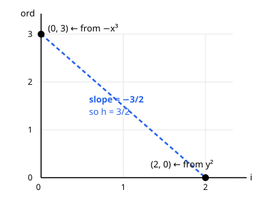
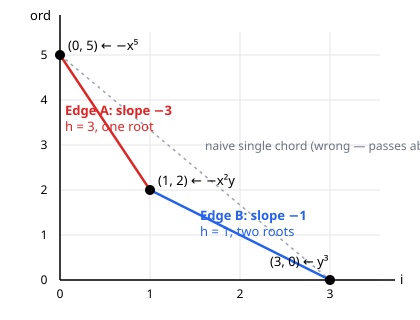

# Newton Polygons and Puiseux Series

> *Written by Claude, as an experiment in having it teach me. Not my own writing.*

### A gentle introduction, from (almost) first principles

*This isn't conceptually hard, but it is dense. Several sections build directly on the one before, so a rushed read leaves nothing to stand on. Each piece below ends with a 🛑 **Pause and check yourself** box: a couple of short questions, meant to be attempted before reading on. They're for your own sake, not graded. The point is to catch a shaky spot while it's still cheap to fix, rather than three sections later.*

---

## 0. The question we're really asking

You already know how to solve a quadratic like $y^2 - y - 1 = 0$ : the quadratic formula gives two numbers. Now make the equation depend on a parameter $x$ :

$$
y^2 - x = 0
$$

For each fixed $x$ this still has two roots, $y = \pm\sqrt{x}$ . But if you try to write $\sqrt{x}$ as a *power series* in $x$ , the kind of expression $a_0 + a_1 x + a_2 x^2 + \cdots$ you'd get from a Taylor expansion, you fail. There is no ordinary power series whose square is $x$ . Squaring a power series always doubles up in a specific sense (we'll make this precise as soon as the right tool is available in Section 1), and that's exactly what rules out a solution: no choice of coefficients can produce a series whose square is "plain $x$ ."

The honest description of the roots is

$$
y = x^{1/2} \quad\text{and}\quad y = -x^{1/2},
$$

expressions with a **fractional exponent**. These are the simplest possible examples of *Puiseux series*. The goal of this lecture is:

1. to define the field of Puiseux series precisely,
2. to show that it is exactly the right place to look for roots of polynomials $F(x, y)$ , and
3. to give you an actual algorithm, the **Newton polygon method**, for computing the leading exponents (and then the full expansions) of those roots by hand.

**Prerequisites:** high-school algebra, the idea of a power series, and comfort with the notion "smallest exponent of $x$ appearing in an expression" (we'll call this the *order*). That's it. No Galois theory, no algebraic geometry.

---

> 🛑 **Pause and check yourself.**
> 1. In your own words, not the lecture's, why can't an ordinary power series square to $x$ ?
> 2. What property would a "power series" need to *gain* for there to be any hope of solving $y^2 = x$ ? (No need to know the fix yet, just name what's missing.)
>
> *If (2) feels like a guess, that's fine. Sections 1 and 2 exist to answer it properly.*

---

## 1. Warm-up: formal power series and their "order"

A **formal power series** in $x$ over the complex numbers is an expression

$$
a(x) = a_0 + a_1 x + a_2 x^2 + a_3 x^3 + \cdots
$$

with $a_i \in \mathbb{C}$ , added and multiplied term by term the way you'd expect (no convergence issues: "formal" means we never plug in a number for $x$ , we just manipulate symbols). The set of these is written $\mathbb{C}[[x]]$ .

If you also allow finitely many *negative* powers, $a(x) = a_{-3} x^{-3} + a_{-2}x^{-2} + a_{-1} x^{-1} + a_0 + a_1 x + \cdots$ , you get the field of **formal Laurent series**, $\mathbb{C}((x))$ . This is a field: every nonzero element has a multiplicative inverse (you can check this by long division, same trick as inverting $1 - x$ via $1 + x + x^2 + \cdots$ ).

For any nonzero Laurent series $a(x)$ , define its **order**

$$
\operatorname{ord}(a) = \text{the smallest exponent of } x \text{ appearing with a nonzero coefficient.}
$$

So $\operatorname{ord}(3x^2 + x^5) = 2$ , and $\operatorname{ord}(x^{-1} + 7) = -1$ . Order behaves like a "valuation": $\operatorname{ord}(ab) = \operatorname{ord}(a) + \operatorname{ord}(b)$ and $\operatorname{ord}(a+b) \ge \min(\operatorname{ord}(a), \operatorname{ord}(b))$ . Keep this function in your head. The whole Newton polygon construction is just a clever way of tracking orders.

$\mathbb{C}((x))$ is already a very good field, but it is **not algebraically closed**: the equation $y^2 = x$ still has no solution in it. Now that $\operatorname{ord}$ is on hand, the obstruction from Section 0 restates cleanly and generally: if $f(x)^2 = x$ for some nonzero $f \in \mathbb{C}((x))$ , multiplicativity gives $\operatorname{ord}(f^2) = 2\operatorname{ord}(f)$ , always an *even* integer, but $\operatorname{ord}(x) = 1$ is odd. Contradiction. This is the real reason, not a coincidence about Taylor coefficients: solving $y^2 = x$ needs a value group where $1$ has a "half," and $\mathbb{Z}$ simply doesn't have one.

---

> 🛑 **Pause and check yourself.**
> 1. If $\operatorname{ord}(a) = 3$ and $\operatorname{ord}(b) = 3$ , what can you say about $\operatorname{ord}(a+b)$ ? Is it forced to equal $3$ , or could it be something else, and if so, under what condition?
> 2. State, in one sentence and using $\operatorname{ord}$ , exactly why $\mathbb{C}((x))$ fails to contain a square root of $x$ .

---

## 2. Puiseux series: allowing fractional exponents

**Fix.** Instead of expanding in $x$ , expand in $x^{1/n}$ for some positive integer $n$ . Formally: $\mathbb{C}((x^{1/n}))$ is the field of Laurent series in the symbol $t = x^{1/n}$ . An element looks like

$$
a(t) = \cdots + a_{-1} t^{-1} + a_0 + a_1 t + a_2 t^2 + \cdots, \qquad t = x^{1/n},
$$

which, rewritten in terms of $x$ , has exponents that are integer multiples of $1/n$ , e.g. $\dots, x^{-1/3}, x^0, x^{1/3}, x^{2/3}, x^{4/3}, \dots$ when $n = 3$ .

Now let $n$ range over **all** positive integers and take the union:

$$
\mathbb{C}\{\{x\}\} := \bigcup_{n \ge 1} \mathbb{C}((x^{1/n})).
$$

This is the field of **Puiseux series**. An element of $\mathbb{C}\{\{x\}\}$ is a series with rational exponents, all sharing a *common denominator* $n$ (different elements may use different $n$ ), and with only finitely many negative exponents. Two useful facts, both easy to believe and not hard to prove:

- $\mathbb{C}\{\{x\}\}$ is a field (same long-division argument as before, done in the variable $t = x^{1/n}$ once you've cleared denominators).
- The order function extends naturally: $\operatorname{ord}(a)$ is now a *rational* number (or $+\infty$ for $a = 0$ ), and it still satisfies $\operatorname{ord}(ab) = \operatorname{ord}(a) + \operatorname{ord}(b)$ , $\operatorname{ord}(a+b) \ge \min(\operatorname{ord}(a), \operatorname{ord}(b))$ .

### Puiseux's theorem

> **Theorem (Puiseux, 1850).** The field $\mathbb{C}\{\{x\}\}$ is algebraically closed: every polynomial $F(x, y) = c_d(x) y^d + c_{d-1}(x) y^{d-1} + \cdots + c_0(x)$ with coefficients $c_i(x) \in \mathbb{C}((x))$ (or even $\mathbb{C}\{\{x\}\}$ ), $c_d \ne 0$ , has all $d$ of its roots (in $y$ , counted with multiplicity) lying in $\mathbb{C}\{\{x\}\}$ .

This is the payoff: as long as you're willing to use fractional exponents, *every* algebraic equation in $y$ over Laurent series in $x$ factors completely, just like polynomials over $\mathbb{C}$ itself. (The theorem holds more generally over any algebraically closed field of characteristic 0 in place of $\mathbb{C}$ .)

So the roots exist. The remaining question, the practical one, is: **how do you actually find them?** That's what the Newton polygon is for.

---

> 🛑 **Pause and check yourself.**
> 1. Why does Puiseux's theorem need $\mathbb{C}$ (or any algebraically closed field) as the base? What would go wrong if you tried to state the same theorem with $\mathbb{Q}$ in place of $\mathbb{C}$ ?
> 2. Quick sanity check: is $x^{1/2} + x^{1/3}$ an element of $\mathbb{C}\{\{x\}\}$ ? (Think about what common denominator its two terms would need.)

---

## 3. Hunting for the leading exponent $h$

Write a polynomial in $y$ with power-series coefficients in $x$ :

$$
F(x, y) = \sum_{i=0}^{d} c_i(x)\, y^i, \qquad c_i(x) \in \mathbb{C}[[x]], \text{ not all zero.}
$$

We want a Puiseux series root $y(x)$ near $x = 0$ . Suppose it has the form

$$
y(x) = \gamma x^h + (\text{higher-order terms}), \qquad \gamma \in \mathbb{C},\ \gamma \ne 0,\ h \in \mathbb{Q},
$$

where $\gamma$ is just a **single complex number**, the *coefficient* of the leading term, not a series in its own right, and $h$ is the exponent. Everything hiding inside "$+\ (\text{higher-order terms})$" is the part still to be pinned down term by term. $\gamma$ and $h$ alone only fix the leading behavior of $y(x)$ , not the whole thing. Right now we know neither of them. Rather than being handed a recipe, let's actually go hunting for $h$ , as if we've never heard of a "Newton polygon," and see what we're forced into.

### 3.1 Substitute the guess, and see what breaks

Plug $y = \gamma x^h + \cdots$ into $F$ and look at what each monomial contributes. To leading order, the term $c_i(x) y^i$ behaves like a nonzero coefficient times $x$ raised to the power

$$
w_i(h) := \operatorname{ord}(c_i) + i h.
$$

( $\operatorname{ord}(c_i)$ is fixed by the polynomial; $ih$ is the extra order that comes from raising our as-yet-unknown $y$ to the $i$ -th power.) So for any trial value of $h$ , $F(x, y(x))$ is a sum of terms, one per surviving $i$ , of orders $w_0(h), w_1(h), w_2(h), \dots$

Here's the question that actually matters: **for $y(x)$ to be a root, $F(x,y(x))$ has to vanish, so what does that force about these orders?**

Suppose, for some trial $h$ , exactly one $i$ achieves the smallest value of $w_i(h)$ . Then that one term is strictly lower order than every other term in the sum. Nothing else is even the same size, so there's nothing for it to cancel against. The sum's leading behavior is just that lone term, with its nonzero coefficient, and the whole thing can't possibly be zero.

**So: a trial $h$ can only work if at least two different $i$ 's tie for the smallest $w_i(h)$ .** That's the entire search criterion, and we didn't have to invent anything to get it. It just fell out of trying to substitute a guess and watching what goes wrong. Now: for which $h$ does a tie actually happen?

> 🛑 **Pause and check yourself.**
> 1. Restate the boxed conclusion above without using the word "tie". What, concretely, has to happen among the terms of $F(x,y(x))$ for $y(x)$ to stand a chance of being a root?
> 2. **Try predicting before reading on:** sketch a handful of points $(i, \operatorname{ord}(c_i))$ on paper. Just from the picture, with no algebra, which points do you think could *never* be involved in a tie, no matter what $h$ is? (§3.2 answers this properly; a hunch is enough for now.)

### 3.2 Finding the ties: slide a ruler and watch

Rephrase the question geometrically. Plot one point $(i, \operatorname{ord}(c_i))$ per surviving $i$ : horizontal axis the power of $y$ , vertical axis the order in $x$ . For a trial $h$ , the quantity $w_i(h) = \operatorname{ord}(c_i) + ih$ is exactly the height at which a **ruler of slope $-h$** , slid straight up from below the whole point set, first bumps into point $i$ . Check the algebra: a line of slope $-h$ at height $c$ above position $i=0$ is $j = c - hi$ ; staying below every point means $c \le \operatorname{ord}(c_i) + hi$ for all $i$ , so the highest legal $c$ is exactly $\min_i w_i(h)$ , achieved at whichever point(s) the ruler touches first. So "which $i$ minimizes $w_i(h)$ " and "which point does a ruler of tilt $-h$ touch" are the same question, just asked two ways.

Our criterion from §3.1 becomes: **we need a tilt at which the ruler touches two or more points simultaneously.** Let's find out when that happens, on a concrete point set first, before worrying about our actual $F$ :

$$
(0, 4), \quad (1, 1), \quad (2, 3), \quad (4, 0).
$$

Compute $w_i(h)$ for each: $4$ , $1+h$ , $3+2h$ , $4h$ . Tilt the ruler by scanning $h$ from large positive values down to $0$ and tracking which point is currently lowest:

- For $h$ very large, $w_0(h) = 4$ is the unique minimum (the $1+h$ , $3+2h$ , and $4h$ terms are all larger once $h$ is big enough), so $(0,4)$ wins outright.
- As $h$ decreases, $1+h$ eventually meets $4$ at $h = 3$ , handing the minimum to $(1,1)$ . Decreasing further, $1+h$ meets $4h$ at $h = 1/3$ , handing the minimum to $(4,0)$ . (Checking the third candidate crossing, $4h = 4$ at $h=1$ : it's never actually realized, since $(1,1)$ is already winning outright by the time $h$ reaches $1$ .)
- So: for $h > 3$ , $(0,4)$ wins alone; **at $h = 3$ , $(0,4)$ and $(1,1)$ tie**; for $1/3 < h < 3$ , $(1,1)$ wins alone; **at $h = 1/3$ , $(1,1)$ and $(4,0)$ tie**; for $0 \le h < 1/3$ , $(4,0)$ wins alone. The point $(2,3)$ never wins at any tilt. It's simply too high up to ever be the lowest.

Notice what just happened: the ties occurred at exactly two tilts, $h=3$ and $h=1/3$ , and nowhere else. Now overlay the **lower convex hull** of these four points, the boundary you'd get by pulling a taut string up from $-\infty$ against them. It consists of the vertices $(0,4)$ , $(1,1)$ , $(4,0)$ ( $(2,3)$ is excluded, because it sits above the segment joining its neighbors), with edges of slope $(1-4)/(1-0) = -3$ and $(0-1)/(4-1) = -1/3$ . **Those are exactly the two tilts where the ruler tied.** This isn't a coincidence: as the ruler's tilt sweeps through every real value, the touching point can only change at a tilt where it hands off from one hull vertex to the next, which is precisely the definition of a hull edge's slope. Ties happen *only* at hull edges, and *every* hull edge produces a tie.

> 🛑 **Pause and check yourself.**
> 1. Why did $(2,3)$ never win at any tilt? What does that reflect geometrically about its position relative to the other three points? (Does this match your hunch from the previous checkpoint?)
> 2. Quick computation: using the same four points, verify for yourself that at $h = 2$ (strictly between the two tie-tilts $1/3$ and $3$ ), $(1,1)$ really does win outright over all three other points.

### 3.3 The payoff: this is the Newton polygon

So our search for candidate $h$ 's has collapsed to a finite, mechanical recipe, one we didn't assume but derived:

1. Plot $(i, \operatorname{ord}(c_i))$ for every surviving $i$ .
2. Compute the **lower convex hull**.
3. Every edge, running from $(i_1,j_1)$ to $(i_2,j_2)$ with slope $-h$ , is a candidate: $h = (j_1-j_2)/(i_2-i_1)$ . That edge accounts for $i_2 - i_1$ roots (with multiplicity); the "Root counting" subsection after the $\gamma$ computation below derives exactly why. Writing $h = p/e$ in lowest terms, the first term of every root on this edge lies in $\mathbb{C}((x^{1/e}))$ . That $e$ is only an *upper bound* on how much ramification is needed, though; the actual denominator a given branch requires can be any divisor of $e$ , and pinning down the real answer takes the refinement pass in Section 6.

This *is* the Newton polygon: not a definition to memorize, but the direct consequence of asking "where can two terms possibly tie?" Points strictly above the hull never win the ruler at any tilt, so they never produce a candidate. That's why only the lower hull matters.

### 3.4 Closing the gap: what the ultrametric inequality buys us

One loose end. §3.1's argument that a lone minimal term "can't cancel" was intuitive but a little hand-wavy. Power series addition is more than just comparing orders, so let's actually verify there's no way around it, and along the way confirm we really can stop the search at the finitely many hull edges and check no other $h$ .

The precise tool is the **ultrametric (non-archimedean) inequality**:

$$
\operatorname{ord}(a + b) \ge \min(\operatorname{ord}(a), \operatorname{ord}(b)), \quad \text{with equality unless the leading coefficients of } a \text{ and } b \text{ cancel.}
$$

(This is the same phenomenon behind $p$ -adic absolute values. It's what makes "order" behave so rigidly, unlike ordinary real-number addition.) Applying it term by term to $F(x,y(x)) = \sum_i c_i(x)(\gamma x^h + \cdots)^i$ gives

$$
\operatorname{ord}\big( F(x, y(x)) \big) \ge \min_i w_i(h),
$$

with equality unless the terms achieving the minimum actually cancel. Now the two cases from §3.1 become airtight:

- **$h$ off the hull** (unique minimizer): equality is forced, because nothing else is around to cancel against, so $\operatorname{ord}(F(x,y(x))) = w_i(h)$ , a finite number, meaning $F(x,y(x)) \ne 0$ . Not a root, full stop. Every such $h$ is ruled out, rigorously.
- **$h$ on the hull** (an edge's slope): two or more terms tie, so the inequality no longer forces equality, and cancellation becomes *possible*. Whether it actually happens is a genuine algebraic question, tackled in the next section.

That's why we can stop: the ultrametric inequality guarantees that **every** $h$ outside the finitely many hull-edge slopes fails, with no further checking required, and it's *only* at those edges that anything remains to be verified. An infinite search over $h \in \mathbb{Q}$ has become a finite list of edges, each with one algebraic equation left to solve.

> 🛑 **Pause and check yourself.** This is the point where the two halves of the argument (§3.1–3.2's geometry and §3.4's algebra) fuse into one claim. It's worth making sure it's solid before moving on.
> 1. Suppose a trial $h$ is *not* equal to any hull edge's slope. Walk through, in your own words, exactly why $F(x,y(x))$ is forced to be nonzero. Don't just say "ultrametric inequality," say what it gives you and why that's enough.
> 2. What's the difference between "the ruler ties at two points" and "$F(x,y(x))$ actually vanishes"? Which one does a hull edge guarantee on its own, and which one still requires separate work?

### 3.5 The edge's height: does the line pass through the origin?

Each edge, at its tie value $h$ , produces a specific finite number $m = \min_i w_i(h)$ , the common weight shared by every point on that edge. Writing the edge as the line $j = m - ih$ in the $(i,j)$ -plane, $m$ is just its **intercept**: plug in either endpoint, $m = j_1 + i_1 h = j_2 + i_2 h$ , and both give the same value by definition of "tie."

It's tempting to guess $m = 0$ . After all, we're hunting for a root, a place where something vanishes. But $m$ is only the **order of the leading term of $F(x,y(x))$ before cancellation**, not the value of $F$ itself, and there's no reason it should be zero. Each edge has its own line and its own intercept, fixed entirely by where the edge sits in the polygon, not by any condition that it pass through $(0,0)$ . Concretely, in the two worked examples below: the single edge in Example 1 has intercept $m = 3$ ; the two edges in Example 2 have intercepts $m = 5$ and $m = 3$ respectively. That's three different lines, none through the origin, each perfectly correct. The *actual* cancellation condition is the edge-polynomial equation for $\gamma$ , just below, a separate, algebraic constraint layered on top of the geometric one.

### 3.6 Two bookkeeping subtleties

- **If several monomials share the same power of $y$ .** In general $c_i(x)$ is itself a whole power series, $c_i(x) = a_{i,0} + a_{i,1}x + \cdots$ , not a single monomial. Only its **order**, the *lowest*-order nonzero term, ever affects the leading-exponent search above. Higher-order terms of $c_i(x)$ only matter once you refine the expansion further (Section 6). This is exactly why we only ever plotted one point $(i, \operatorname{ord}(c_i))$ per power of $y$ , no matter how many terms in $x$ that coefficient has.
- **Edges are never vertical, and can be horizontal.** Since each $i$ contributes at most one point, the hull always progresses strictly left to right, so vertical edges simply can't occur. A **horizontal** edge (slope $0$ , i.e. $h=0$ ) is perfectly normal, though: it flags a batch of roots that stay finite and nonzero as $x \to 0$ , i.e. $y(x) = \gamma + (\text{higher order})$ with $\gamma \ne 0$ , ordinary Taylor-expandable roots hiding among the fractional-exponent ones.

### Finding the leading coefficient $\gamma$

The search above only pinned down $h$ ; $\gamma$ is still unknown. Once you know $h = p/e$ from an edge, substitute $y = \gamma x^h + \cdots$ into just the monomials $c_i(x) y^i$ for $i$ on that edge (the ones tied for the minimum), extract the coefficient at the common order $m$ , and set it to zero. This produces an ordinary one-variable polynomial in $\gamma$ , the **edge polynomial** (or *characteristic polynomial* of the edge), whose coefficients are complex numbers (specifically, the leading coefficients of the $c_i(x)$ 's involved) and whose only unknown is $\gamma$ ; "in $\gamma$ alone" means *one variable*, not *no other coefficients*. Its nonzero roots, **counted with multiplicity**, give the candidate leading coefficients. A *simple* root of the edge polynomial lifts cleanly to one genuine branch $y = \gamma x^h + \cdots$ . A *repeated* root is not automatically a repeated branch, though. It only means two or more roots share the same leading term, and you need a further refinement pass (Section 6) to tell whether they're genuinely distinct branches that merely agree to this order, or a true multiple root. This is the algebraic check that §3.4 left open: it's where you finally learn whether the tie you found actually cancels, possibly leaving more work to do before the branches separate. ("Why does the multiplicity even transfer to $F$ at all?" is a fair question in its own right. The "Root counting" subsection just below addresses it directly.)

### Root counting: why the numbers have to add up

One thing got used silently back in the construction (§3.3, step 3) and again in Example 2 below without ever being justified: an edge from $(i_1,j_1)$ to $(i_2,j_2)$ contributes exactly $i_2 - i_1$ roots. Where does that number actually come from? It falls straight out of the edge polynomial just defined.

**Isolating the edge polynomial's degree.** Let $S$ be the set of $i$ with $(i, \operatorname{ord}(c_i))$ lying exactly on the edge (usually just the two endpoints, but collinear lattice points in between are allowed and do occur). Substituting $y = \gamma x^h$ and extracting the coefficient at order $m$ gives

$$
E(\gamma) = \sum_{i \in S} b_i \gamma^i, \qquad b_i = \text{leading coefficient of } c_i(x),
$$

with $b_{i_1}$ and $b_{i_2}$ both nonzero (they're the edge's endpoints). Since we assumed $\gamma \ne 0$ from the start (a root with $\gamma=0$ would just mean the true leading exponent is larger than $h$ , a different edge or a different case entirely), factor out the smallest power present:

$$
E(\gamma) = \gamma^{i_1} \cdot \tilde{E}(\gamma), \qquad \tilde{E}(\gamma) = \sum_{i \in S} b_i \gamma^{i - i_1}.
$$

$\tilde{E}(\gamma)$ is now an honest polynomial of degree exactly $i_2 - i_1$ (its top coefficient $b_{i_2}$ and bottom coefficient $b_{i_1}$ are both nonzero by construction), and its roots are exactly what we want. The discarded $\gamma^{i_1}$ factor only ever contributed the spurious $\gamma=0$ we'd already excluded. Since $\mathbb{C}$ is algebraically closed, $\tilde{E}(\gamma)$ has exactly $i_2 - i_1$ roots, counted with multiplicity. That's the count, derived rather than assumed.

**Checking it against both worked examples below**, once you've read them: Example 1's single edge has $i_2-i_1 = 2-0 = 2$ , matching its two roots $\gamma = \pm 1$ . Example 2's Edge A has $i_2-i_1=1-0=1$ (one root, $\gamma=-1$ ), Edge B has $i_2-i_1=3-1=2$ (two roots, $\gamma=\pm1$ ), totaling $1+2=3 = \deg_y F$ . No coincidence, as the next paragraph shows.

**Why the grand total always matches $\deg_y F$ .** Summing $i_2-i_1$ over consecutive edges telescopes to $(\text{largest } i) - (\text{smallest } i)$ , i.e. $d - i_{\min}$ , where $d = \deg_y F$ and $i_{\min}$ is the smallest power of $y$ with $c_i(x) \not\equiv 0$ . If $i_{\min} = 0$ (the usual case, $F(x,0) \not\equiv 0$ ), the hull's edges alone account for all $d$ roots, exactly matching Puiseux's theorem. If $i_{\min} > 0$ , then $F(x,0) \equiv 0$ , meaning $y \equiv 0$ is itself a root, of multiplicity exactly $i_{\min}$ (the smallest power of $y$ dividing $F$ ), and that trivial root makes up the difference: $i_{\min} + (d - i_{\min}) = d$ . Either way, the books balance.

### When $\gamma$ repeats, does the multiplicity actually transfer to $F$ ?

There's a gap in what's been said so far. If the edge polynomial $E(\gamma)$ has a root $\gamma_0$ of multiplicity $k > 1$ , the *edge polynomial's* bookkeeping is fine (it still contributes $k$ to the total of $i_2-i_1$ ), but that's a statement about $E$ , a different (much simpler) polynomial than $F$ . It doesn't yet say anything about $F$ itself having $k$ genuine roots sharing that leading term. That has to be checked.

**What's actually true.** Shift $y = \gamma_0 x^h + z$ and form $G(x,z) = F(x, \gamma_0x^h+z)$ , the same substitution Section 6 uses for refinement, just applied here to interrogate a repeated root instead of a simple one. Then: **exactly $k$ of $G$ 's roots (with multiplicity) go to $z \to 0$** , i.e. exactly $k$ of $F$ 's original roots genuinely share the leading term $\gamma_0x^h$ . The multiplicity does transfer, but as a theorem to invoke, not an assumption to make.

**Why.** Taylor-expand $G$ in $z$ :

$$
G(x,z) = \sum_j \frac{1}{j!} F_y^{(j)}(x, \gamma_0x^h)\, z^j,
$$

where $F_y^{(j)}$ denotes the $j$ -th partial derivative in $y$ . Differentiating the edge's terms $j$ times brings down a factor from each $i$ and reduces the power of $y$ by $j$ , matching up exactly with differentiating $E(\gamma)$ itself $j$ times at $\gamma_0$ . The upshot: the order (in $x$ ) of $G$ 's $z^j$ coefficient is governed by $E^{(j)}(\gamma_0)$ . Since $\gamma_0$ has multiplicity $k$ , $E(\gamma_0) = E'(\gamma_0) = \cdots = E^{(k-1)}(\gamma_0) = 0$ but $E^{(k)}(\gamma_0) \ne 0$ . So $G$ 's coefficients of $z^0, \dots, z^{k-1}$ are all pushed to *higher* order than the naive continuation of the edge would predict, while the $z^k$ coefficient lands exactly where expected. That's precisely the geometric signature (§3.2) of a fresh Newton polygon whose relevant portion has horizontal length $k$ , so re-running the method on $G$ finds exactly $k$ roots with $z \to 0$ , no more and no fewer.

**Checking it concretely.** Take $F(x,y) = (y-x)^2 - x^3$ . Its Newton polygon has a single edge through $(0,2)$ , $(1,1)$ , $(2,0)$ , all three collinear, slope $-1$ , with edge polynomial $E(\gamma) = \gamma^2 - 2\gamma + 1 = (\gamma-1)^2$ : a genuine double root at $\gamma_0=1$ . Shift $y = x + z$ : direct computation gives

$$
G(x,z) = F(x, x+z) = z^2 - x^3,
$$

exactly Example 1's polynomial. *Its* edge polynomial has two distinct roots ( $z \approx \pm x^{3/2}$ ), confirming $k=2$ roots with $z \to 0$ , matching the double root exactly. And indeed $F(x,y)=0$ factors as $y = x \pm x^{3/2}$ : two genuinely distinct branches sharing the leading term $y \sim x$ , exactly as promised, not a true repeated root of $F$ . (The same shift-and-check pattern holds at any multiplicity, e.g. $F=(y-x)^3-x^4$ shifts to $G=z^3-x^4$ under $y=x+z$ , cleanly separating into $k=3$ roots. Working through the general induction that makes this airtight for every case is more than fits here; it's the same machinery behind the constructive proof of Puiseux's theorem itself.)

---

> 🛑 **Pause and check yourself.** This closes out Section 3, the whole theory. Everything from here on is just *using* it. A fresh numeric test, not drawn from anywhere above:
> 1. Suppose a hull has an edge running from $(1,2)$ to $(4,-1)$ . What's the candidate exponent $h$ for this edge?
> 2. How many roots (with multiplicity) does this one edge account for?
> 3. If you got $h=1$ , sanity-check it against §3.5: does a slope of $-1$ through $(1,2)$ land at $j=-1$ when $i=4$ ? (If not, recheck your arithmetic before moving on. This is exactly the kind of slip worth catching now rather than mid-example.)

---

## 4. Worked example 1: a single edge

Let

$$
F(x, y) = y^2 - x^3.
$$

Only two monomials: $y^2$ (coefficient $c_2(x) = 1$ , order $0$ ) and $-x^3$ (coefficient $c_0(x) = -x^3$ , order $3$ ). Points: $(2, 0)$ and $(0, 3)$ .

With only two points, the "lower hull" is just the segment joining them, from $(0,3)$ to $(2,0)$ . Slope:

$$
\frac{0 - 3}{2 - 0} = -\frac{3}{2} \quad\Longrightarrow\quad h = \frac{3}{2}.
$$

So $y(x) = \gamma x^{3/2} + \cdots$ . Plug in: $y^2 - x^3 = \gamma^2 x^3 - x^3 = (\gamma^2 - 1) x^3 + \cdots$ , so $\gamma^2 = 1$ , $\gamma = \pm 1$ . This matches what you already know: $y = \pm x^{3/2}$ are exactly the two roots of $y^2 = x^3$ , and indeed they are genuine Puiseux series (with denominator $e = 2$ , matching $2 = i_2 - i_1$ over one batch).

---

> 🛑 **Pause and check yourself.** Without redoing the full computation: if the equation had instead been $y^2 = x^5$ , what would change about the plotted points, the slope, and $h$ , and what would stay exactly the same about the method used to find them?

---

## 5. Worked example 2: two edges, showing the method's real power

Let

$$
F(x, y) = y^3 - x^2 y - x^5.
$$

Three monomials:

- $y^3$ : coefficient $1$ , order $0$ , so point $(3, 0)$
- $-x^2 y$ : coefficient $-x^2$ , order $2$ , so point $(1, 2)$
- $-x^5$ : coefficient $-x^5$ , order $5$ , so point $(0, 5)$

Plot $(0,5), (1,2), (3,0)$ and take the lower hull. Check the two candidate edges:

- From $(0,5)$ to $(1,2)$ : slope $(2-5)/(1-0) = -3$ .
- From $(1,2)$ to $(3,0)$ : slope $(0-2)/(3-1) = -1$ .

The naive chord from $(0,5)$ straight to $(3,0)$ passes *above* the point $(1,2)$ , so it is not the lower hull. The true hull dips down through $(1,2)$ .

Since $-3 < -1$ (slopes increase left to right), **both** segments lie on the lower hull: the point $(1,2)$ is a genuine vertex, not cut off. So we get two edges, meaning two families of roots with different leading behavior:

**Edge A: $(0,5) \to (1,2)$ , slope $-3$ , so $h = 3$ .** This edge has $i_2 - i_1 = 1$ , so it accounts for exactly **one** root. Only the monomials at $i=0$ and $i=1$ participate: $-x^5 - x^2 y$ . Substitute $y = \gamma x^3 + \cdots$ : the $-x^2 y$ term gives $-\gamma x^5$ , and together with $-x^5$ we need $-\gamma x^5 - x^5$ to vanish at leading order, i.e. $\gamma = -1$ . So one root begins $y = -x^3 + \cdots$ .

**Edge B: $(1,2) \to (3,0)$ , slope $-1$ , so $h = 1$ .** Here $i_2 - i_1 = 2$ and the slope $-1 = -1/1$ is already in lowest terms ( $e=1$ ), so this edge contributes **two** roots, both with leading exponent $1$ , i.e. of the form $y = \gamma x + \cdots$ . The participating monomials are those at $i = 1$ and $i = 3$ : $-x^2 y + y^3$ . Substituting $y = \gamma x$ :

$$
y^3 - x^2 y = \gamma^3 x^3 - \gamma x^3 = (\gamma^3 - \gamma)\, x^3.
$$

Setting the bracket to zero and discarding the spurious root $\gamma = 0$ (that would mean the term isn't actually leading order; it belongs to a different, more precise expansion) gives $\gamma^2 = 1$ , $\gamma = \pm 1$ . So two more roots begin $y = x + \cdots$ and $y = -x + \cdots$ .

Altogether, $F$ has three roots (matching $\deg_y F = 3$ ):

$$
y_1 = -x^3 + \cdots, \qquad y_2 = x + \cdots, \qquad y_3 = -x + \cdots
$$

exactly the count and rough shape the Newton polygon predicted, with no guesswork about which powers of $x$ to try.

---

> 🛑 **Pause and check yourself.**
> 1. What did the naive chord from $(0,5)$ to $(3,0)$ get wrong, and what specifically did the true vertex $(1,2)$ do to correct it?
> 2. Verify the root-counting bookkeeping yourself: Edge A's length plus Edge B's length should equal $\deg_y F$ . Do the numbers actually add up here, and would they still add up if $F(x,0)$ had been identically zero instead?

---

## 6. Going further: from leading term to full series

Once you know a root's leading term $\gamma x^h$ , you find the *next* term by substituting $y = \gamma x^h + z$ back into $F$ and repeating the same Newton-polygon analysis on the new, "shifted" polynomial in $z$ . This is sometimes called the **Newton–Puiseux algorithm**, and it's the $y$ -analogue of Newton's method / Hensel lifting: each pass pins down one more exponent and coefficient of the answer. Repeating it determines successive terms of a chosen branch. In general the resulting Puiseux series is **infinite**: a generic algebraic root doesn't terminate any more than a generic Taylor series does ( $\sqrt{1+x} = 1 + \tfrac{x}{2} - \tfrac{x^2}{8} + \tfrac{x^3}{16} - \cdots$ never stops, for exactly the same reason). What Puiseux's theorem actually guarantees is narrower but still enough: every branch's exponents lie in $\tfrac{1}{n}\mathbb{Z}$ for a single fixed $n$ , a bounded denominator, not a bounded number of terms.

**Trying it once, on Example 2's $y_1 = -x^3 + \cdots$ root.** Substitute $y = -x^3 + z$ into $F(x,y) = y^3 - x^2y - x^5$ and expand in $z$ :

$$
F(x, -x^3+z) = z^3 - 3x^3 z^2 + (3x^6 - x^2)\, z - x^9.
$$

Now re-run the whole method on *this* polynomial in $z$ . The coefficient of $z$ is the single series $c_1(x) = 3x^6 - x^2$ , not two separate points, whose order is $\operatorname{ord}(c_1) = 2$ (the $-x^2$ term dominates; per §3.6, only the lowest-order part of a coefficient ever matters here). So the points are $(3,0)$ from $z^3$ , $(2,3)$ from $-3x^3z^2$ , $(1,2)$ from $c_1(x)$ , and $(0,9)$ from $-x^9$ . Checking the lower hull, the edge that matters is $(1,2)$ – $(0,9)$ : slope $(2-9)/(1-0) = -7$ , so the next exponent is $7$ . The edge polynomial from the surviving terms $-x^2 z - x^9 \approx 0$ gives $z \approx -x^7$ . So

$$
y_1 = -x^3 - x^7 + \cdots,
$$

one genuine refinement pass, exactly as promised, and nothing stops you from shifting again by $z = -x^7 + z'$ to get the term after that.

---

> 🛑 **Pause and check yourself.**
> 1. True or false, with a reason: every Puiseux series terminates after finitely many terms, because its exponents have a bounded denominator.
> 2. In the worked refinement above, what changed about the *method* on the second pass compared to the first, and what stayed exactly the same?

---

## 7. Why this matters (a quick map of where it's used)

- **Algebraic curve singularities.** If $F(x,y) = 0$ defines a plane curve, the Newton polygon at a singular point tells you how many analytic branches pass through it and their tangent directions/multiplicities. This is the starting point for resolving singularities of curves.
- **Valuation theory / local fields.** The order function $\operatorname{ord}$ is a valuation, and Puiseux series form an **algebraic closure** of $\mathbb{C}((x))$ , the same relationship $\mathbb{C}$ has to $\mathbb{R}$ ( $\mathbb{C}$ is an algebraic closure of $\mathbb{R}$ , not a completion of it). Completion is a separate question from closure, and it splits the two fields apart: $\mathbb{C}((x))$ is already complete under its discrete $x$ -adic valuation, so nothing more is needed there. The Puiseux field $\mathbb{C}\{\{x\}\}$ , however, is *not* complete under its extended, $\mathbb{Q}$ -valued version of that valuation. Its completion is the strictly larger field of Hahn series (rational-exponent series whose support is merely well-ordered, not finitely-many-negative-terms). This valuation-driven perspective is a template that recurs for $p$ -adic fields, function fields, etc.
- **Tropical geometry.** The Newton polygon construction, done for many variables and iterated, is literally the definition of *tropicalization*: replacing a polynomial by the combinatorics of the exponents/orders of its coefficients. Puiseux series are the standard base field for tropical geometry precisely because their valuation captures this so cleanly.
- **Asymptotics and perturbation theory.** In applied math, "Newton polygon" methods are the systematic version of the ad hoc "try $y \sim x^\alpha$ " trick used to find the leading behavior of solutions to perturbed/degenerate equations.

---

> 🛑 **Pause and check yourself.** A lighter one, more reflection than computation: of the four applications just listed, which one connects most directly to the ruler-sliding picture from §3.2, and can you say in a sentence *why* that connection holds?

---

## 8. A couple of exercises

1. Find the Newton polygon and leading exponents of all roots of $F(x,y) = y^4 - 2x y^2 + x^2 - x^3$ . (Hint: two of the roots will need a second refinement pass to distinguish them, because the leading terms alone coincide.)
2. Show directly, using only the definition of order, that if $a, b \in \mathbb{C}\{\{x\}\}$ are nonzero then $\operatorname{ord}(ab) = \operatorname{ord}(a) + \operatorname{ord}(b)$ .
3. Explain, using the Newton polygon, why $F(x,y) = y^2 - x$ (order-2 point at $(2,0)$ , order-1 point at $(0,1)$ ) forces the denominator $e = 2$ , and connect this back to Section 1.

---

*A good next step after this lecture is to work through the Newton–Puiseux algorithm on a slightly larger example by hand (degree 4 or 5 in $y$ ), then compare against a computer algebra system's `puiseux` or `algcurves` package to check your work.*
