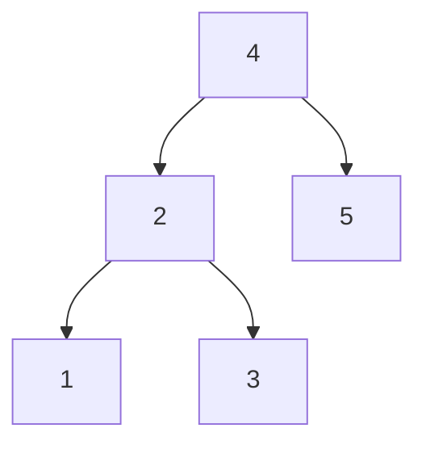
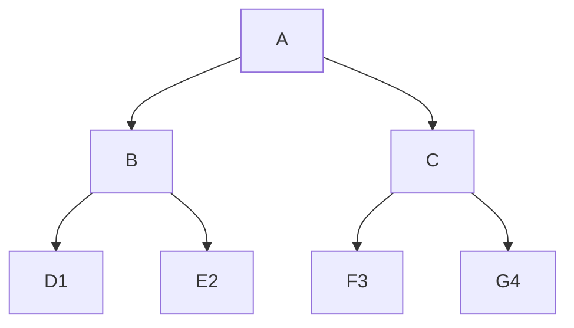
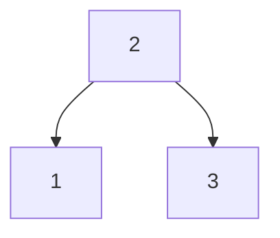

[https://sci-hub.st/https://doi.org/10.1137/S0097539795291598](https://sci-hub.st/https://doi.org/10.1137/S0097539795291598)

# 為甚麼讀這篇論文？

有一天我在 Backend TW 介紹一篇 LeetCode 答案的時候，多謝網友 Kakaen 介紹，其實早就該讀這篇論文了。這篇論文講得是 prefix sum 的 lower bound，lower bound 論文總是有趣的。

# 背景知識

這篇論文要求的背景知識不少，這裡會佔很多的篇幅，會的話可以跳過，或者快速複習一下就可以了。

### Lower bound

在 algorithm 的世界裡，我們一般講 upper bound，主要是想說明某個 algorithm 最多使用多少 resources。說明某個 algorithm 最少使用多少 resources 一般來說沒甚麼用，因為最快的 case 總是很快的，例如 input 是 null 就迅速結束，但那又如何呢？

所以在 algorithm 的世界裡，講 lower bound，是講問題的 lower bound，就是說，任何一個 algorithm 出 solve 某某的 problem 都必須花上的 resources。

難點當然是「任何」algorithm ⋯ 你怎麼知道所有的 algorithms？

### Computational Model

如果我說我的 algorithm 是問神仙，可以極速完成，那你能說明我對還是錯嗎？最少有爭議性吧。所以我們需要 computational model 這個概念。Computational model 限制了可能的 algorithm。比如說一定要用電腦來算，又或者是說 sorting 必須只使用比較等等 ⋯

### Semigroup

Semigroup 是一個抽象代數的 construction，它是一個 set $S$ 和一個我們叫做 $+$ 的 operation，符合這些 axiom

Closure: 對於任何的 $x, y \in S$ ， $x + y \in S$

Associativity: 對於任何的 $x, y, z \in S$ ， $(x + y) + z = x + (y + z)$

這些看起來都很合理，但注意這些並不是數字，只是某某 set $S$ 裡面的一些 elements 而已﹐可以這樣想，我們把數字裡面的「一些」properties 抽出來單獨討論。

難點不在於已有 property，難點在於沒有的 properties。例如在 Semigroup 裡，我們必須忘記減法，減法沒有任何的 axiom 去說明它的存在。我們甚至沒辦法自己把它構造出來，例如所有 2x2 matrix 的乘法就符合 Semigroup 條件，但 non-invertible matrix 是沒辦法用 inverse 做減法。

> 題外話 ⋯ 這就是為甚麼 ring 比 field 難那麼多 ⋯

除了沒有減法之外，我們還必須忘了 $x + y = y + x$ 這個事，因為它在 semigroup 裡也不是事實，counterexample 還是 matrices。還好，這篇論文用的是 Commutative semigroup，正好把這個補上。

### Segment Tree

Segment tree 是一個常用的技巧，簡單來說，就是把一個 array segment 用一個 tree 來表示。具體的 construction 是這樣：

- 如果 array segment 的 length 是 1，它是 leaf node

- 否則把它對半分，左邊程右邊 recursively construct。

這樣，一個 array 可以變成一個 tree，這樣做會把空間使用由 $O(n)$ 變成 $O(n \log n)$ 。[^segment-tree-space] 這樣做的原因是因為我們可以在非 leaf node 中存儲一些 subtree (i.e. subarray) 的 summary，例如 sum。

放 summary 是為了 query 用。如果我有一些 range query 問 summary，而這個 range 正好包含全個 subtree，那麼只要在返回已經記下的 summary 就可以了。否則可以拆散這個 range 問 subtrees。

# Prefix Sum 問題

我們想問，given 一個 array，我們可以進行兩種操作：

- update(j, x) 會把 array\[j\] 變成 array\[j\] + x，或者
- query sum(j) 要返回 array\[1\] + … + array\[j\] 的值。

> 是的，論文都喜歡 array start with 1。

這個問題並不難解決，使用 segment tree，

`update（j, x)`: 可以用 $O(\log n)$ 時間找到對應 `array[j]` 的 leaf node，然後把整條 path 的所有 summary 都加 x 就可以了。

`query(j)`: 如果 root node 正好是對應 `[0 - j]`，那直接返回 summary 就好，否則有兩個可能性

- $j$ 比中間值小 - 這時候 recursive 到左 subtree 就好
- $j$ 比中間值大 - 這時候 recursive 到右手邊，再加上左手邊 subtree 的整個 summary 就好

這個算法無論是 update 還是 query，都是 $O(\log n)$ 。

問題是有沒有可能更快，這份論文說在 commutative semigroup computational model 下，不能。

通篇筆記， $N$ 都是 array 的 length。

## Commutative semigroup computational model

上面已經介紹過 Commutative semigroup，其實說白了，就是只允許加法，不允許減法或其它方法。

在只能用加法的限制下，其實可以進一步限制做論文中指定的 U R system。

我們可以有很多個 variable (論文中用 register，但其實和 variable 的意義一樣），然後有 $N$ 個 sets $U\_j$ 和另外 $N$ 個 sets $R\_j$ ，這些 sets 裡面放的是 variables，它們分別是這樣用的：

處理 `update(j, x)` 時，把 $U_j$ 裡面的所有 variable 都加 $x$ 。

處理 `query(j)` 時，把 $R_j$ 裡面的所以 variable 加起來返回。

這個 scheme 可以 model 一個最簡單的 case，precompute all answers

對應 $j \in [1, N]$ ， $v\_j$ 是一個 variable 代表 $\sum\limits\_{i = 1}^{j} \text{array}[i]$

$R\_j$ 自然是 $\lbrace  v\_j \rbrace$

$U\_j$ 是 $\lbrace v1 \cdots v\_j\rbrace$ 。[^prefix-update-set]

不難看出這個 algorithm 沒有問題。

這個 scheme 自然也可以對應到 segment tree，只是表遠比較複雜一點。每一個 tree node 都有一個 variable

$U_j$ 是 `update(j, x)` 會更新的 node 對應的 variables。

$R_j$ 是 `query(j)` 時會加的 node 對應的 variables。

> 感覺作者寫到這裡就開始認定 Commutative semigroup computational model == UR system，但 UR system 假設了 U 和 R 都是 constant over time，難保沒有 algorithm 能允許 U 和 R 有變化進而更快 ⋯ 這我沒有讀到哪裡有說明這點。

## 充份必要條件

當然，不是所有的 UR system 都能解決 prefix sum 問題，UR 全是空集合這個情況就明顯不能。

那甚麼 UR system 可以呢？有沒有充份必要的條件呢？有：

$$
|U_i \cap R_j| = \begin{cases} 1 \text{ if } i \le j& \\
0 \text{  otherwise}\end{cases}
$$

### 必要：

如果 $i \le j$ 和 $|U\_i \cap R\_j| \ne 1$ ，要麼現在 `query(j)` 就不對，或者 `update(i, x)` 後 $R\_j$ 的總值加了不是 exactly 一次所以 update 後 `query(j)` 不對。

如果 $i \gt  j$ 和 $|U\_i \cap R\_j| \ne 0$ ，要麼現在 `query(j)` 就不對，或者 `update(i, x)` 後 $R\_j$ 的總值變化了所以 update 後 `query(j)` 不對。

### 充份：

我們假設一開始 array 所有 element 的值都是 0 (\*)，我們之後會拿掉這個假設的。

首先，把所有 variable 的值都設定為 0，在沒有任何 update 的情況下，這個 UR system 能夠正確 handle 任何 query，反正全是 variable 全是 0，加任何 subset 都是 0，答案也全是 0。

假設當前是 variable 狀態是對的，再做一個 update，跟據條件，所有 $i \le j$ 的 $R\_j$ 都會加了 $x$ ，然後這是正確的 partial sum，然後所有 $i \gt  j$ 的 $R\_j$ 都會不變，那也是正確的 partial sum。

所以用 induction，所有的操作都不會導致 partial sum 錯誤，這個 UR system 是正確的。

最後，假設 array 一開始的值不是 0，我們只有從 0 開始，一個一個 element update 只到 array 原來的初始就好了。

> (\*) 因為我們的 computational model 是 commutative semigroup，它不一定有 0，這個情況下我們可以加一個 0 給它，定義 0 + x = x + 0 = x，這並不影響這個證明的結果。

最後，設 `update(j, x)` 的 probability 為 $p\_j$ ，`query(j)` 的 probability 為 $q\_j$ ，那麼 UR system 的 expected running time 是 $C(p, q) = \sum\limits\_{i = 1}^N p\_j|U\_j| + \sum\limits\_{i=1}^{N}{q\_j |R\_j|}$ 。[^cost-index]

# Bi-weighted tree

話鋒一轉，作者突然提出這份論文的第二個主角，Biweighted tree。

神奇的是，隨意的一棵樹就能挑出一個可以 solve partial sum problem 的 UR system 出來。

## 任何 binary tree 都可以變 UR system！

考慮一棵有 $N$ 個 node 的 binary tree，我們把所有 leaf nodes 從左到右，由 $1$ 到 $N$ label 起來，這樣的話，每一個 leaf node $j$ 都有一條 parent chain 一直到 root。我們設：[^tree-ur-construction]

每一個 node 都是一個 variable。

- node $j$ 屬於 $U_j$ ，
- 如果在往上找 parent 的 path 上，node $x$ 是 node $y$ 的左 child，那麼 $x$ 屬於 $U_j$ ，[^tree-ur-construction]
- node $j$ 屬於 $R_j$ ，
- 如果在往上找 parent 的 path 上，node $x$ 是 node $y$ 的右 child，那麼 $x$ 屬於 $R_j$ ，[^tree-ur-construction]

沒有任何其它東西屬於 $U\_j$ 和 $R\_j$

這個設計的關鍵點在於 $U\_i \cap R\_j$ 在 $i \le j$ 的情況下會是它們的 least common ancestor，否則沒有。

而這一點並不難看到，如果 $i$ 在 $j$ 左邊，它們的 least common ancestor 確實能做到這一點，否則它們也有 least common ancestor，因為左右反了，所以不屬於 $U\_i \cap R\_j$ 。

接下來，作者給這棵樹加上 weights﹐具體來說，是每一個 leaf node 都有兩個 weights：

第 $i$ 個 leaf node 一直走到 root 途中會經過 $l\_i$ 條向左走的 edge，和 $r\_i$ 條向右的 edge﹐我們就把 $l\_i$ 和 $r\_i$ 想成是這個 leaf node 的兩個 weights，所以我們叫它 bi-weighted tree。

留意 $l\_i$ 其實是 $|U\_i| - 1$ ，因為每一條向左走嘅 link 都會 1:1 map 去一個 $U\_i$ 的 node，除了 leaf 本身。同樣道理 $r\_i = |R\_i| - 1$ 。

### Tree → UR system 例子：

假設我們有這個 binary tree：

利用上述的 construction，可以得出 UR system

| Node | U | R |
| --- | --- | --- |
| 1 | \{1, 2, 4\} | \{1\} |
| 2 | \{2, 4\} | \{2\} |
| 3 | \{3, 4\} | \{2, 3\} |
| 4 | \{4\} | \{4\} |
| 5 | \{5\} | \{4, 5\} |

### Cost

和 UR system 的 expected running time 比較，對於某一棵 tree，我們可以定義 

$$
W(T, p, q) = \sum\limits_{i=1}^N p_i l_i +  \sum\limits_{i=1}^N q_i r_i
$$

利用 $l\_i = |U\_i| - 1$ 和 $r\_i = |R\_i| - 1$ ，可以寫

$$
C(p, q) = W(T, p, q) + \sum\limits_{i=1}^{N}p_i + \sum\limits_{i=1}^{N}q_i = W(T, p, q) + 1
$$

## UR system ⇒ tree

我們知道一棵 bi-weighted tree，對應一個 valid UR system，但一個 valid UR system，可以對應一棵 tree 嗎？

### u-extent 定義

在這裡，論文的論述有倒過來，這裡我嘗試正面地敍述。首先我們定義 u-extent，我們有兩種 u-extent，論文只給了 u-extent 的定義，卻沒有任何的 intuition ⋯ 我嘗試加一些 examples 去理解。下圖是一個 segment tree ⋯

**定義：** 一個 variable $x$ 的 $\text{u-extent}(x)$ 是 $\max(j | x \in U_j)$ 。

**Examples:**

如果考慮 segment tree，u-extent 指的其實是 subtree 中最右的一個，看圖比較容易理解：

比如說， $\text{u-extent}(B) = 2$ ，因為 $B$ 在 $U\_1$ 和 $U\_2$ 。

考慮一個簡單的 UR-system keep track 所有的 partial sum，那麼每一個 partial sum variable 的 u-extent 就很明顯的 partial sum 的長度。

考慮一個 UR system keep 所有 value，所有 variable 只管自己的 variable，所以 u-extent 就是它管的那個 variable。

其實每一個 variable 必然是一個 set of array entry 的 sum，然後 u-extent 指的就是這個 sum 裡面最大的 array index。

**定義：** 一個 $R\_j$ 的 $\text{u-extent}(R\_j)$ 是 $\min(\text{u-extent}(x) | x \in R\_j)$ 。

**Examples:**

同樣，考慮 segment tree 的 case， $\text{u-extent}(R_j)$ 是算 partial sum 時第一個要的 subtree 的最右。

而 keep track 所有 partial sum 的 case $R\_j$ 永遠只會有 partial sum 那個 variable，所以 $\text{u-extent}(R\_j)$ 也就是 partial sum 的 length $j$ 。

考慮一個 UR system keep 所有 value，要找的時候就一個一個加，所有 $j$ 的 $\text{u-extent}(R_j)$ 都是 1。

其實每一個 partial sum 是一堆 variable 的 sum，這些 variable 由總是一堆 array entry 的 sum，所以 u-extent of $R_j$ 其實就是看看那一個 array-entry 的 sum 的最大 index 最小。

我們選 $k = \max(\text{u-extent}(R\_j))$ ，然後我們可以選一個 $k'$ 使 $\text{u-extent}(R\_{k'}) = k$ 。

**Examples:**

考慮 segment tree 的 case， $\text{u-extent}(R_4) = 4$ ，所以 $k = 4$ ， $k'$ 也是 $4$ 。

而 keep track 所有 partial sum 的 case， $\text{u-extent}(R_4) = 4$ ，所以 $k$ 還是 $4$ ， $k'$ 也是 $4$ 。

考慮一個 UR system keep 所有 value，要找的時候就一個一個加，所有 $j$ 的 $\text{u-extent}(R_j)$ 都是 1，所以 $k$ 也是 1。

### 建樹

整體來說，我們找到的 $k$ 是 root。我們希望把 $m \in [1, k - 1]$ 的部份變成一個新的 valid UR system 做左 subtree，而 $n \in [k + 1, N]$ 部份做右 subtree。

首先，對於所有 $x \in R\_j$ ，我們肯定 $\text{u-extent}(x) \le j$ (重要 Property)。如果不是，假設有一個 $y \in R\_j$ ， $\text{u-extent}(y) = m \gt  j$ ，那麼 update array entry $m$ 的時候， $R\_j$ 就會有變化，這明顯不對 ⋯

自然 $k \le k'$

### 左 subtree

使用 $k = \text{u-extent}(R\_{k'})$ 的定義，我們知道 $R\_{k'}$ 裡面的 variables 每一個的 u-extent 都最少有  $k$ 那麼多，然而當 $m \in [1, k - 1]$ ，所以 $m \lt  k \lt  k'$ ， $|U\_m \cap R\_{k'}| = 1$ ，所以每一個 $U\_m$ 總會有一個 variable $x\_m$ 它的 $\text{u-extent}(x\_m) \ge k$ 。同時， $R\_m$ 裡的 variable 的 u-extent 最大只能是 $m \lt  k$ (重要 Property)，所以 u-extent 大於 $k \gt  m$ 的 $x\_m$ 必然不在任何一個 $R\_m$ 裡。

到這裡，我們先把 $U\_m$ 和 $R\_m$ 都抽出來，知道每一個 $U\_m$ 裡都有一個有一個 element $x\_m$ ，它不在任何 $R\_m$ 裡。這樣，假如我們從每一個 $U\_m$ 裡面把 $x\_m$ 刪掉，它都不可能改變 $U\_{m\_1} \cap R\_{m\_2}$ 的值，這個是一個 valid 的 左 UR system，inductively 我就建好了 left subtree。

### 右 subtree

因為 $k$ 是所有 $R$ 的最大 u-extent，所以所有 $R$ 的 u-extent 都 $\le k$ 。然而當 $n \in [k+1..N]$ ，所以 $n \gt  k$ ，所以每一個 $R\_n$ 總會有一個 variable $x\_n$ 它的 $\text{u-extent}(x\_n) \le k$ 。如果 $x\_n$ 在任何一個 $U\_n$ 裡，那麼 $\text{u-extent}(x\_n) \ge n \gt  k$ ，就會矛盾，所以  $x\_n$ 不在任何一個 $U\_n$ 裡。

到這裡，我們再把 $U\_n$ 和 $R\_n$ 都抽出來，知道每一個 $R\_n$ 裡都有一個有一個 element $x\_n$ ，它不在任何 $U\_n$ 裡。這樣，假如我們從每一個 $R\_n$ 裡面把 $x\_n$ 刪掉，它都不可能改變 $U\_{n\_1} \cap R\_{n\_2}$ 的值，這個是一個 valid 的 右 UR system，inductively 我就建好了 right subtree。

> 吐糟一秒 ⋯ 這一小段眼瞎了，做 example 又犯了個小錯誤，多謝 Andy 網友的指點，才找到錯誤的地方，花了將近一個星期的時間，最終看通這一段。其中比較重要的一點，就是要把前面的 goal 放心裡去才能理解這些 property 的意義。我一開始嘗試用一個 logical 的順序去 present 雖然沒有錯﹐但較難理解。

### UR system → tree 例子：

這個是一個 input UR system

| i | U | R |
| --- | --- | --- |
| 1 | \{A,B,D\} | \{D\} |
| 2 | \{E,A\} | \{E,B\} |
| 3 | \{C\} | \{C,A\} |

先算一下 variables 的 u-extent

| Variable | u-extent |
| --- | --- |
| A | 2 |
| B | 1 |
| C | 3 |
| D | 1 |
| E | 2 |

再算 R 的 u-extent

| R | u-extent |
| --- | --- |
| 1 | 1 |
| 2 | 1 |
| 3 | 2 |

最後得出 $k = 2$ 。

算左 subtree

| m | $U\_m - \lbrace x\_m\rbrace$ | $R\_m$ |
| --- | --- | --- |
| 1 | \{A, B, D\} - \{B\}[^left-subtree-example] | \{D\} |

算右 subtree

| n | $U\_n$ | $R\_n - \lbrace x\_n\rbrace$ |
| --- | --- | --- |
| 3 | \{C\} | \{C, A\} - \{A\} |

明顯不用再 recurse 下去了，因為它們都只能是 leaf node，所以 tree 就是

### Cost[^unfinished-cost]

[^segment-tree-space]: **勘誤：** 每個 node 只保存 constant-size summary 的普通 segment tree 使用 `O(n)` 空間。這裡有 `n` 個 leaves 和 `n - 1` 個 internal nodes，合共 `2n - 1` 個 nodes；並不是 `O(n log n)`。

[^prefix-update-set]: **勘誤：** 更新第 `j` 個 entry 會改變第 `j` 到第 `N` 個 prefix sums，所以應是 `U_j = {v_j, v_(j+1), ..., v_N}`。例如更新最後一個 entry，只應更新 `v_N`，而不是所有較短的 prefix sums。

[^cost-index]: **勘誤：** Summation index 是 `i`，但 summand 用了 `j`。應寫成 `C(p, q) = sum_{i=1}^N p_i|U_i| + sum_{i=1}^N q_i|R_i|`。

[^tree-ur-construction]: **勘誤：** 要和下面的五個 nodes 的例子一致，應把所有 nodes（不只是 leaves）按 inorder label 為 1 到 `N`。沿 parent chain 往上走，若 child `x` 是 parent `y` 的左 child，加入 `U_j` 的是 parent `y`；若是右 child，加入 `R_j` 的也是 parent `y`。例如例子中的 `U_1` 要包含 ancestors 2 和 4。原文加入 child `x` 的規則得不到這個結果，也不滿足所述 intersection 條件；後面的 weights 亦應對每一個 labelled node 定義。

[^left-subtree-example]: **例子不一致：** 前面的 construction 要選 u-extent 最少為 `k = 2` 的 `x_m`，但這裡刪掉的 `B` 的 u-extent 是 1；符合所述條件的是 `A`。刪掉 `B` 在這個只有一個 index 的左 UR system 中仍然不會改變 intersection，但它不是前面證明所指定的選擇。

[^unfinished-cost]: **未完成：** 這個 Cost 小節目前沒有內容。尚需說明由一般 UR system 建出的 tree 的 cost 不大於原 system（扣除每次操作的固定成本），才能完成兩者最優 cost 的比較。
