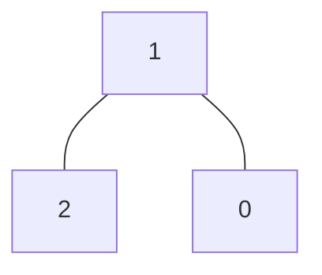
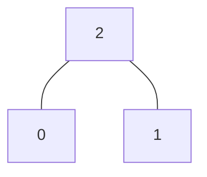
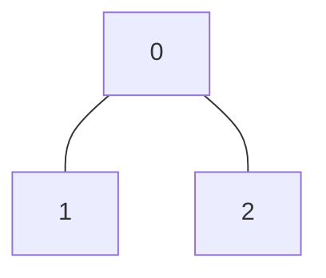
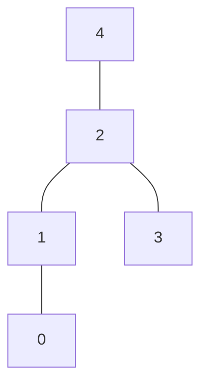

最近想嘗試下些關於 tree 的實驗，一個相對容易的方法，就是 enumerate 所有 trees 來試。

Prufer's Code 是一個相對方便的方法。

內容來自 A course in combinatorics 的第 12 - 13 頁

[https://library.lol/main/598ED4B4CCE2AE26FCDF4B206044C1C7](https://library.lol/main/598ED4B4CCE2AE26FCDF4B206044C1C7)

## 書中問題：labelled tree of n-vertices 有幾個？

所謂 labelled tree，是指 node 有 label，而形狀一樣，label 不一樣的 tree，以下三個算不同的 trees。










答案是 $n^{n-2}$ ，留意當 $n = 3$ ， $n^{n-2} = 3$ 就是上面三個。要證明這個結果，其中一個方法就是用 Prufer’s code。

## 用 Prufer’s code construct tree

假如我有一個 array $A$ ，它的 length 是 $n - 2$ ，它的 entries 是 $0 \cdots n - 1$ 的整數，這樣的一個 array 我們叫做 Prufer’s code。我可以用它來 construct 一個 tree，方法如下：

定義 $A[n-2]$ 為 $n$ 。[^prufer-sentinel]

定義 $B$ 是一個 length 為 $n - 1$ 的 array，它的值待定。

由於 $A$ 只有 $n - 1$ 個值，但 $0 \cdots n - 1$ 有 $n$ 個值，所以總有最少一個沒有被用到的，我們在這些數值中找一個最小的，它就是 $B[0]$ 。

假設我們已知 $B[0]$ 到 $B[i - 1]$ ，要找 $B[i]$ ，我們考慮 $B[0] \cdots B[i-1]$ 和 $A[i] \cdots A[n-2]$ ，這裡也有 $n - 1$ 個數值，所以也總有最少一個沒有被用到的，我們在這些數值中找一個最小的，它就是 $B[i]$ 。

找到 $B[0]$ 到 $B[n - 1]$ 後， $(A[i], B[i])$ 就是一棵樹的 $n - 1$ 條 edges。[^prufer-index]

### 真的是樹嗎？

嗯，真的。我們已經知道它有 $n - 1$ 個 edges，只要證明它是沒有 cycle 就可以了。

如果它有 cycle，在這 $n - 1$ 條 edges 裡，總有最先一條的 cycle edge，就設是 $(A[c], B[c])$ 好了。By construction，對於所有 $k \gt  c$ ， $B[c]$ 不可能等於任何 $A[k]$ 或者 $B[k]$ ，所以其實 $B[c]$ 根本沒有在後面有任何的 cycle edge 連上它，這就是個矛盾。

例子

| i | 0 | 1 | 2 | 3 |
| --- | --- | --- | --- | --- |
| A | 1 | 2 | 2 | 4 |
| B | 0 | 1 | 3 | 2 |

## 用 tree construct Prufer’s code

Given 任何一個 binary tree，也能 construct 出對應的 Prufer’s code：[^prufer-tree-scope]

留意第一個 $B[0]$ 的值必然是

1. 只出現一次，和
2. 在合資格的 leaf 中最小的

所以我們要找到 $A[0], B[0]$ 的時候，找一個值最少的 leaf 就可以了。

想像我們在 tree 中把 $A[0], B[0]$ 除掉，接下來的情況其實是一樣的

$B[1]$ 也是

1. 在刪掉 $A[0], B[0]$ 後只出現一次，和
2. 在合資格的 leaf 中最小的

所以其實要找一個完整的 code，只需要做 $n - 2$ 次移除最小的 leaf 就可以了。

### 例子




移除順序是

| **Parent** | **Leaf** |
| --- | --- |
| 1 | 0 |
| 2 | 1 |
| 2 | 3 |

所以 code 是 \[1, 2, 2\]

## 實驗代碼[^prufer-traversal]

```py
import heapq 

class TreeNode:
    def __init__(self, val=0):
        self.val = val
        self.children = []

    def add_child(self, n):
        self.children.append(n)

a = TreeNode(0)
b = TreeNode(1)
c = TreeNode(2)
d = TreeNode(3)
e = TreeNode(4)
b.add_child(a)
b.add_child(c)
c.add_child(d)
c.add_child(e)

root = b

# Convert the given tree to a format convenient for Prufer code construction
# neighbor is a map from a node's value to all of its neighbor's value
# leaves is the set of leaf values 

def walk(parent, node, neighbors, leaves):
    my_neighbors = [c.val for c in node.children]
    if parent is not None:
        my_neighbors.append(parent.val)
    neighbors[node.val] = my_neighbors
    degree = len(my_neighbors)
    if degree == 1:
        leaves.append(node.val)
    else:
        for child in node.children:
            walk(node, child, neighbors, leaves)

neighbors = {}
leaves = []
walk(None, root, neighbors, leaves)

# By converting the leaves into a min heap, we can repeatedly remove minimal leaves
heapq.heapify(leaves)
size = len(neighbors)
code = []
for i in range(size - 2):
    smallest_leaf = heapq.heappop(leaves)
    my_neighbors = neighbors[smallest_leaf]
    parent = my_neighbors[0]
    code.append(parent)
    parent_neighbors = neighbors[parent]
    parent_neighbors.remove(smallest_leaf)
    parent_degree = len(parent_neighbors)
    # If the parent of a leaf becomes degree 1, it becomes a leaf as well
    if parent_degree == 1:
        heapq.heappush(leaves, parent)

# Now we have the code, we can try to reconstruct the tree
size = len(code) + 2
code.append(size - 1)
chosen = []
forbidden = {}
allowed = []

# Using a counter for each value to count how many time it is forbidden
for c in code:
    if c not in forbidden:
        forbidden[c] = 0
    forbidden[c] += 1

# Anything that is not forbidden is eligible 
for i in range(size):
    if i not in forbidden:
        heapq.heappush(allowed, i)

for i in range(size - 1):
    chosen.append(heapq.heappop(allowed))
    # After an edge is recovered, the parent is forbidden one less time
    forbidden[code[i]] -= 1    
    # And if the value is no longer forbidden, we can allow it
    if forbidden[code[i]] == 0:
        heapq.heappush(allowed, code[i])

# This prints the tree edges
print(code)
print(chosen)

```

## 應用

enumerate labelled trees，這個很明顯，enumerate Prufer’s code 是 trivial，然後 convert to tree 就好，否則並不特別容易 enumerate labelled tree。

random sample labelled tree，同樣道理，不難 uniformly random Prufer’s code。

## 總結

所有 code 和所有 tree 之間是一個 bijection。我們明顯有 $n^{n-2}$ 個 code，所以必然有 $n^{n-2}$ 個 labelled tree。

[^prufer-sentinel]: **勘誤：** Labels 的範圍是 0 到 `n - 1`，所以這個 construction 要 append 的 sentinel 是 `n - 1`，不是 `n`。否則最後一條 edge 會連到不存在的 vertex `n`。後面的五個 vertices 的例子使用 4，Python 亦用了 `code.append(size - 1)`，兩者才是正確的。

[^prufer-index]: **勘誤：** `B` 的 length 是 `n - 1`，合法 indices 是 0 到 `n - 2`。所以應是找到 `B[0]` 到 `B[n - 2]`，並取 `0 <= i <= n - 2` 的 edges。

[^prufer-tree-scope]: **適用範圍：** 這個 encoding 適用於所有 labelled trees，不只是 binary trees。為了證明最後所述的 bijection 和 Cayley’s formula，這一方向也必須涵蓋所有 labelled trees。

[^prufer-traversal]: **代碼錯誤：** `walk` 在 `degree == 1` 時把 node 加入 leaves 後便不再走 children。對非 root 的 leaf 沒問題，但 root 若只有一個 child，它的 degree 也是 1，於是整棵 subtree 都被略過。例如以 endpoint 為 root 的三點 path，只會建立 root 的 neighbors entry。應把「記錄 leaf」和「遍歷 children」分開，不要用這個 `else` 阻止 recursion。
